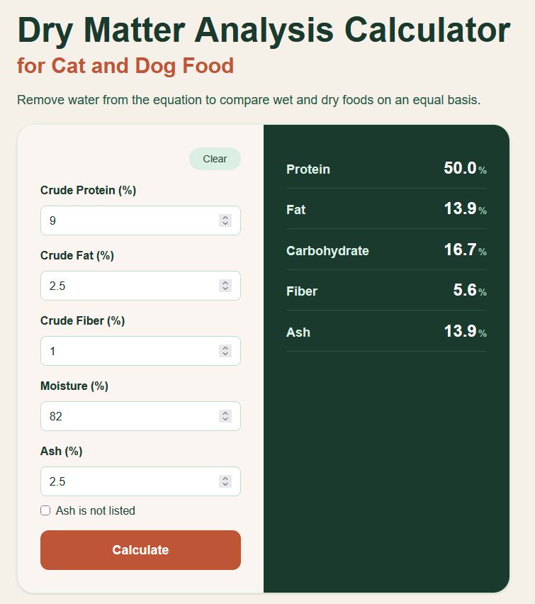

This is a [Next.js](https://nextjs.org) project bootstrapped with [`create-next-app`](https://nextjs.org/docs/app/api-reference/cli/create-next-app).

## Live Site

[https://dry-matter-analysis.vercel.app/](https://dry-matter-analysis.vercel.app/)


## About

This is a website I made with React and Next.js. When I shop for cat food, I like to know the composition, such as the protein %, fat %, and carbohydrate % so I can buy healthy food for my cat. I didn't like any of the dry matter analysis calculators online, so I decided to make my own. This website is deployed on Vercel and uses Vercel analytics. I used Claude Code to guide me through the process.



## Getting Started

First, run the development server:

```
npm run dev
```

Open [http://localhost:3000](http://localhost:3000) with your browser to see the result.

To see how your build will run:

```
npm run build
```

The site is deployed on Vercel. Every push to `master` triggers a new build and updates the live site automatically.
